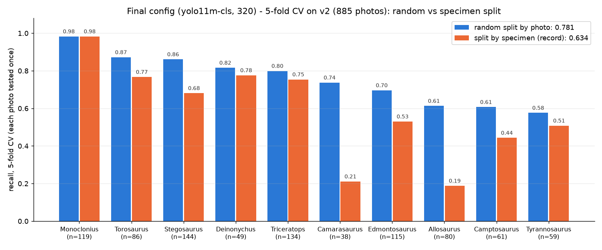
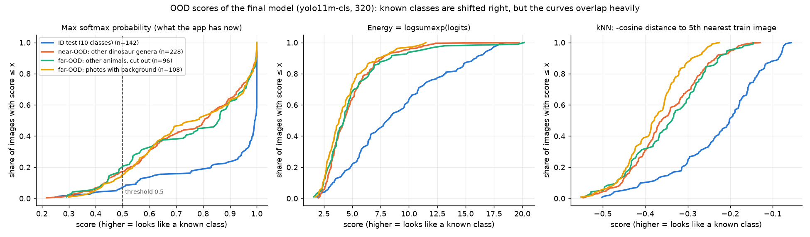
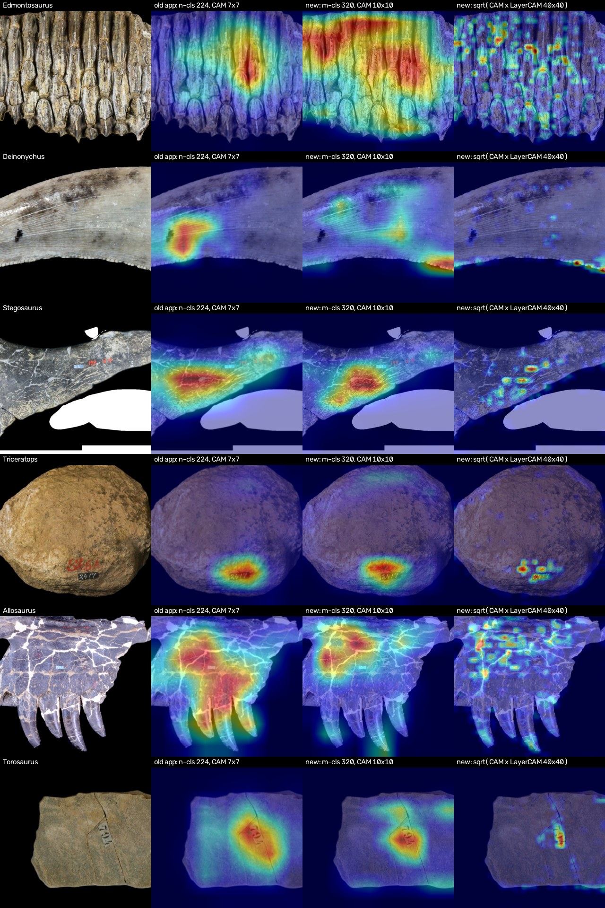
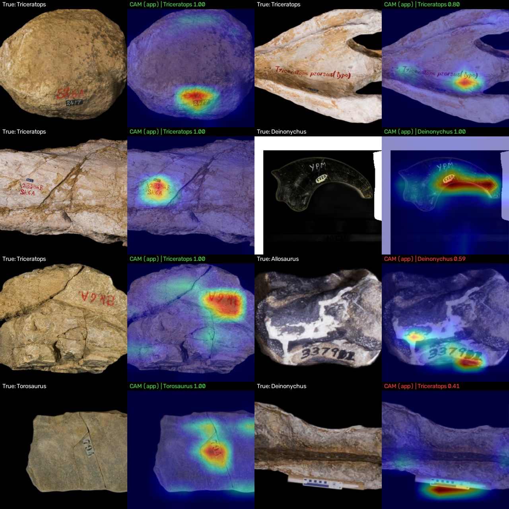
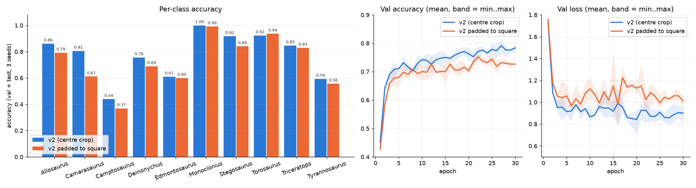

# Аналіз фінальної моделі: поділ за зразком, OOD, Grad-CAM

Фінальна конфігурація скрізь: `yolo11m-cls`, imgsz 320, freeze 7, 30 епох, dropout 0.8, wd 0.005, degrees 15,
scale 0.7, flipud 0.5, erasing 0.6, RandAugment. Датасет v2 (10 класів, 885 оригінальних фото).
Фінальна модель: `results_yolo/yolo_11m_v2_10_classes_best-150` (val 0.781, test 0.817).

## Головне

1. **Поділ за зразком: 0.634** [0.602, 0.665] проти 0.781 при випадковому поділі (5-fold CV на тих самих 885 фото). Стара модель мала 0.620. Новий конфіг майже не покращує узагальнення на нові екземпляри. Помилки групуються за геологічною формацією.
2. **OOD за ймовірностями відсіюється погано.** AUROC 0.76 (MSP) – 0.81 (kNN). Поріг MSP 0.5 відсіює лише ~17% чужих фото.
3. **Outlier exposure (клас Unknown)** відсіює 72–82% нових родів. Ціна — 8 п.п. точності. Модель при цьому значною мірою реагує на фон.
4. **Фото з фоном:** базова модель має на них 0.60 проти 0.81 на вирізаних кістках. У застосунку фон не прибирається.
5. **Grad-CAM** став 10×10 (було 7×7), додано детальний LayerCAM для ілюстрацій. Знайдено shortcut: ≈6% test-фото, де модель дивиться на намальований номер чи напис.
6. **Доповнення фото до квадрата погіршує** результат на 4–5 п.п. Залишено центральний кроп.

## 1. Поділ за зразком (5-fold CV)

Скрипт `overnight_testing/exp5_group_cv_v2.py`, результати `results_yolo/cv_v2/`.

Обидва розбиття робляться на тих самих 885 фото, і кожне фото рівно один раз потрапляє в test:
- **за зразком**: усі фото одного запису GBIF/Yale в одному фолді (`clever_split_core.group_key`);
- **випадкове**: стратифіковане по фото, як у фінальній моделі.

Val у кожному фолді — 12% груп/фото з решти, лише для вибору `best.pt`. Train доповнюється офлайн-аугментацією до 150 фото на клас.

| Розбиття | top-1 (95% ДІ Вілсона) | std між фолдами | top-3 | top-5 |
|---|---|---|---|---|
| випадкове (по фото) | **0.781** [0.752, 0.807] | 0.032 | 0.933 | 0.971 |
| за зразком (по запису) | **0.634** [0.602, 0.665] | 0.057 | 0.843 | 0.918 |
| для порівняння: стара модель (yolo11n, 224, 9 класів), за зразком | 0.620 [0.582, 0.657] | | 0.847 | 0.921 |

Висновки:
- **Різниця становить 15 п.п.** Випадковий поділ оцінює, як модель впізнає вже бачені екземпляри з інших ракурсів. Поділ за зразком оцінює, як вона визначає рід для нового екземпляра. Обидві цифри коректні, але відповідають на різні питання. Це не витік даних, а межа варіативності даних.
- **Найбільше падають класи, де кілька великих записів дають більшу частину фото.** Allosaurus: два записи по 20 і 17 фото, падіння з 0.61 до 0.19. Camarasaurus: один запис — 19 з 38 фото, падіння з 0.74 до 0.21.
- **Помилки при поділі за зразком мають геологічний характер.** Allosaurus і Camarasaurus найчастіше стають Stegosaurus: усі троє з формації Моррісон, пізня юра, з однаковим кольором і станом збереження. Edmontosaurus найчастіше стає Triceratops: обидва з Hell Creek / Lance. Тобто модель частково вчить «формацію» (колір, текстура породи), а не лише форму кістки. Це узгоджується з колірним експериментом v3 (`../v2_vs_v3_comparison/README.md`).
- **Monoclonius лишається 0.98 в обох розбиттях.** Увесь клас — один запис (кістки одного черепа), тому групою тут є окреме фото. Справжньої оцінки «новий екземпляр» для цього класу не існує.
- **Нова конфігурація за зразком: 0.634 проти 0.620 у старої моделі**, ще й з додатковим класом Tyrannosaurus. Різниця в межах довірчого інтервалу. Більша модель і роздільність покращують впізнавання бачених екземплярів, але майже не покращують узагальнення на нові.

## 2. OOD: відсіювання фото, які не належать жодному з 10 класів

Скрипти: `data_preparation/build_ood_set.py` (набір) і `ood_eval.py` (оцінка). Результати: `results_yolo/ood_eval/`.

Набір OOD (`datasets/ood`, відтворюється скриптом; вручну вилучені фото перелічено в `data_preparation/ood_removed.txt`):

| Набір | Що це | Фото |
|---|---|---|
| near | інші роди динозаврів (40 родів, той самий конвеєр, що й датасет; 5 родів, відкинутих через малу кількість фото, + інші з `merged_dataset`) | 228 |
| far | не-динозаври з GBIF (мамонт, мастодонт, бізон, кінь, смілодон, мегалонікс, алігатор, мозазавр, іхтіозавр, плезіозавр), той самий конвеєр rembg + вирізання кісток; + `accepted_results/test_unknown/human.png` | 96 |
| far_raw | ті самі фото GBIF без обробки (з фоном, лінійками) — так їх завантажив би користувач | 108 |

Таксони вищого рівня, що можуть містити навчальні роди (Theropoda, Hadrosauridae, Ceratopsidae...), і синоніми (Morosaurus = Camarasaurus, Trachodon...) не беруться.

Методи (більше = «схоже на відомий клас»):
- **MSP** — максимальна softmax-ймовірність. Це те, що зараз віддає ONNX.
- **MaxLogit** і **Energy** (logsumexp логітів) — потребують логітів у ONNX.
- **kNN** — косинусна відстань до 5-го найближчого навчального фото в просторі ознак голови (1280-d).
- **Mahalanobis** — відстань до центру найближчого класу.

OOD ділиться навпіл за записом на tune та eval. Звіт рахується на ID test (142) + OOD eval.

| Метод | AUROC near | AUROC far | AUROC far_raw | AUROC near+far | FPR@95TPR near+far |
|---|---|---|---|---|---|
| MSP | 0.769 | 0.750 | 0.760 | 0.763 | 0.863 |
| MaxLogit | 0.788 | 0.779 | 0.820 | 0.786 | 0.869 |
| Energy | 0.790 | 0.781 | 0.825 | 0.787 | 0.837 |
| **kNN** | **0.817** | **0.807** | 0.872 | **0.814** | 0.908 |
| Mahalanobis | 0.640 | 0.614 | 0.878 | 0.632 | 0.850 |

Поріг MSP (усі OOD-фото; `msp_thresholds.csv`):

| Поріг MSP | ID test пройшло | точність серед прийнятих | near відсіяно | far відсіяно | far_raw відсіяно |
|---|---|---|---|---|---|
| 0.5 | 0.930 | 0.864 | 0.171 | 0.198 | 0.148 |
| 0.6 | 0.866 | 0.886 | 0.307 | 0.323 | 0.296 |
| 0.7 | 0.845 | 0.900 | 0.417 | 0.375 | 0.463 |
| 0.8 | 0.817 | 0.905 | 0.487 | 0.448 | 0.519 |
| 0.9 | 0.768 | 0.917 | 0.640 | 0.615 | 0.630 |

Висновки:
- **Жоден метод не відділяє OOD надійно** (AUROC 0.76–0.81). Близько 40% OOD-фото отримують MSP > 0.9. Модель упевнено відносить кістку мамонта чи мозазавра до одного з 10 родів, бо ознаки «музейне фото скам'янілої кістки на чорному фоні» спільні.
- **Далекий OOD не легший за близький.** Модель відрізняє не «динозавр / не динозавр», а «схоже / не схоже на навчальні фото».
- **Energy і MaxLogit кращі за MSP на 2–3 п.п. AUROC**, але потребують логітів на виході ONNX-моделі.
- **kNN кращий на 5 п.п.** і працює з ознаками, які ONNX-модель уже віддає (`features`, 1280 × 10 × 10). Для нього потрібен банк ознак навчальних фото (~615 × 1280 float, ~3 МБ).
- **Mahalanobis не працює** через мало фото на 1280 вимірів.
- **Поріг 0.5 — лише відправна точка.** Він відсіює менше 20% OOD. Пороги застосунку (0.8 «висока» / 0.5 «середня» впевненість) працюють як підказка користувачу, але не як відсіювання.

## 3. Grad-CAM

Скрипт `gradcam_yolo.py`. Результати для всього test — `results_yolo/yolo_11m_v2_10_classes_best-150/gradcam_test/` (зображення + `cam_stats.csv`).

Голова класифікатора: conv → GAP → Linear. Тому Grad-CAM по ній дорівнює простому CAM, і саме його застосунок будує з ONNX без градієнтів. Роздільність карти = imgsz / 32:
- **стара модель:** 7×7 (224);
- **нова модель:** **10×10** (320).

Тобто карта стає детальнішою через більший вхід моделі. Самі фото ті самі.

Що додано в `gradcam_yolo.py`:
- **LayerCAM** по шару `model.4` (stride 8, 40×40 при 320). Детальна карта, але потребує градієнтів, тож лише Python (для ілюстрацій у дипломі).
- **`fused` = sqrt(CAM × LayerCAM).** Області, важливі для класу, з деталізацією LayerCAM.
- **TTA:** усереднення з віддзеркаленим зображенням, менше артефактів сітки.
- **Метрика `bone_share`:** частка «маси» карти на кістці (фон чорний). Для порівняння: кістка займає 58% кадру.
- **imgsz тепер береться з моделі.** Інтерфейс `YoloGradCAM(weights, size)(path)` для `tools/export_onnx.py` не змінився.

| Модель / карта | bone_share (142 test) |
|---|---|
| стара (n, 224), CAM 7×7 | 0.859 |
| нова (m, 320), CAM 10×10 (як у застосунку) | 0.877 |
| нова, LayerCAM 40×40 | 0.883 |
| нова, sqrt(CAM × LayerCAM) | 0.898 |

**Shortcut learning.** Приблизно на 8 зі 142 test-фото (≈6%) максимум карти лежить на намальованому каталожному номері, рукописному написі чи лінійці, а не на формі кістки (`gradcam_shortcuts.jpg`, список у `gradcam_shortcuts.txt`):
- три різні кістки одного запису Triceratops (1317198756) — модель щоразу дивиться на код «SK6A»;
- Torosaurus — на номер «767»;
- Triceratops — на напис «Triceratops prorsus (type)».

При випадковому поділі ці номери є і в train, тож модель може «впізнавати екземпляр за номером». Це ще одне пояснення різниці 0.78 / 0.63 у розділі 1.

## 4. Центральний кроп відрізає частину кістки

При валідації та передбаченні (і в застосунку) фото зменшується так, щоб коротка сторона дорівнювала 320, потім вирізається центральний квадрат. У видовжених кісток кінці відрізаються:

| Показник (val + test v2, 270 фото) | Значення |
|---|---|
| середня частка кістки, яка не потрапляє в кадр | **25%** (медіана 19%) |
| фото, де втрачено > 20% кістки | 49% |
| фото, де втрачено > 40% кістки | 29% |
| фото зі співвідношенням сторін > 1.5 | 53% |

Фон фото і так чорний, тому природне виправлення — доповнити фото чорним до квадрата (`data_preparation/make_square.py`).

Перевірка: фінальна конфігурація на копії v2, доповненій до квадрата. Швидкий режим, 3 сіди, ті самі train/val/test. Прогони `v2exp_sq_f7_m_img320_sa*`, таблиці `square_pad_*.csv`.

| | val | test | test top-5 | мін. val loss | val loss у кінці | стрибки val loss (mean \|Δ\|) |
|---|---|---|---|---|---|---|
| **v2, центральний кроп** | **0.799** ± 0.012 | **0.808** ± 0.016 | 0.979 | 0.78 | 0.90 | 0.066 |
| v2, доповнено до квадрата | 0.763 ± 0.005 | 0.761 ± 0.046 | 0.967 | 0.87 | 1.01 | 0.103 |

**Результат негативний, лишаємо центральний кроп.** Доповнення гірше на 3.6 п.п. val і 4.7 п.п. test, loss вищий і стрибає сильніше. Покращився лише Torosaurus.

Причина: у квадраті видовжена кістка займає меншу частину кадру. На вході 320 px губиться дрібна текстура поверхні (шви, пори, зуби), а саме на неї модель спирається найбільше. Центральний кроп працює як «збільшення» на середину кістки. Це вказує, що модель визначає рід більше за текстурою і фактурою поверхні, ніж за загальним силуетом. Це узгоджується з розділами 1 і 3.

## 5. Outlier exposure (клас Unknown)

Скрипт `overnight_testing/exp6_outlier_exposure.py`, результати `results_yolo/oe_v2/`.

Фінальна конфігурація + 11-й клас **Unknown**: 158 train + 27 val фото з половини родів near і far. OOD поділено **за родом**, тож оцінка йде на родах, яких модель не бачила:
- near: 99 фото;
- far: 39 фото;
- far_raw: 50 фото (тих самих far-родів, з фоном).

Порівняння з базовими моделями `v2exp_f7_m_img320_sa*` (ті самі дані, без Unknown), по 3 сіди. Поріг MSP по 10 класах — 95% ID val проходить.

| | базова | outlier exposure |
|---|---|---|
| ID test top-1 (Unknown = помилка) | **0.808** | 0.725 |
| ID test, передбачено Unknown | 0 | 0.101 |
| ID test пройшло (не Unknown і MSP ≥ поріг) | 0.955 | 0.866 |
| точність серед прийнятих ID | 0.831 | 0.827 |
| near (нові роди динозаврів) відсіяно | 0.098 | **0.724** |
| far (нові роди не-динозаврів) відсіяно | 0.085 | **0.821** |
| far_raw (ті самі, з фоном) відсіяно | 0.133 | **0.933** |

На вирізаних кістках outlier exposure працює значно краще за будь-яку оцінку з розділу 2: 72–82% OOD відсіяно проти ~10%. Ціна — 10% своїх фото модель відносить до Unknown, і top-1 падає на 8 п.п.

**Застереження щодо фото з фоном.** Перевірка на 138 сирих фото GBIF десяти навчальних родів з фоном, лінійками й етикетками (як їх надіслав би користувач; `oe_v2/raw_id_photos_with_background.csv`):

| | базова | outlier exposure |
|---|---|---|
| top-1 (Unknown = помилка) | 0.604 | 0.275 |
| передбачено Unknown | 0 | **0.662** |

- **OE-модель вчить «фон / не вирізана кістка = Unknown».** Тому 93% на far_raw — здебільшого ефект фону, а не розпізнавання «не динозавра».
- **Базова модель на фото з фоном має лише 0.60** проти 0.81 на вирізаних. У застосунку фон не прибирається: `ImagePreprocessor` лише робить resize і crop. Отже, реальна точність у застосунку нижча за звітну, якщо користувач не завантажує вже вирізану кістку.

Висновок: outlier exposure найкраще відсіює OOD на вирізаних кістках, але лише за умови того самого видалення фону, що й у датасеті (rembg u2net + `tools/remove_bg_split_new.py`). Без нього більшість реальних фото потрапляє в Unknown. У застосунку outlier exposure не використовується.

## 6. Експорт в ONNX

`tools/export_onnx.py` експортує модель в ONNX (imgsz береться з моделі) і перевіряє експорт на test v2:
- top-1 збігається з PyTorch на 100%, різниця ймовірностей 0;
- CAM з ONNX відрізняється від Grad-CAM на 1e-5;
- вихід `features` 1×1280×10×10.
